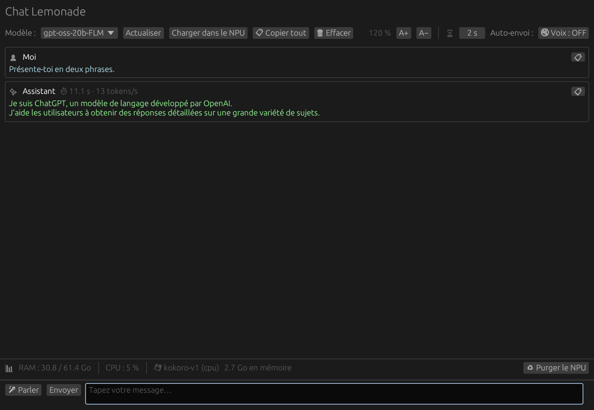

# chat-local

Interface graphique en Rust (eframe/egui) pour discuter — au clavier **et à la voix** — avec les LLM locaux servis par [Lemonade](https://github.com/lemonade-sdk/lemonade) via son API compatible OpenAI (`http://localhost:13305/v1`). Conçu pour les PC à NPU (AMD Ryzen AI), 100 % local, aucune donnée ne quitte la machine.

 



## Téléchargement

Vous pouvez télécharger les binaires pré-compilés pour Linux et Windows sur la page des **[Releases](https://github.com/misterfly-labo/chat-local/releases/latest)** :

*   **Arch Linux** : Paquet `.pkg.tar.zst` (installation via `sudo pacman -U ...`)
*   **Windows 11** : Archive `.zip` contenant l'exécutable natif

## Fonctionnalités

- **Chat complet** : historique conservé et renvoyé au modèle à chaque message, bulles de messages avec retour à la ligne automatique
- **Sélection et chargement du modèle** : menu déroulant listant les modèles du serveur, chargement automatique dans le NPU à la sélection, restauration du dernier modèle utilisé au démarrage
- **Chat vocal bidirectionnel** :
  - 🎤 **Toi → modèle** : enregistrement micro via PipeWire (`pw-record`), transcription par Whisper (`/v1/audio/transcriptions`)
  - 🔊 **Modèle → toi** : synthèse vocale française par Kokoro (`/v1/audio/speech`)
  - **Mains libres** : détection de silence adaptative — après ton temps de silence réglable (1 à 10 s, défaut 4 s), l'enregistrement s'arrête et la question part automatiquement au modèle
- **Réglages persistés** (dans `~/.config/chat-local/config.json`) : dernier modèle, voix ON/OFF, délai d'auto-envoi, taille de police
- **Stats en direct** : RAM, charge NPU, CPU, mémoire du processus ; temps de génération et débit (tokens/s) par réponse
- **Confort** : zoom de police (A−/A+), copie d'un message ou de tout l'historique (presse-papiers persistant), effacement de la conversation
- **Interface 100 % réactive** : toutes les requêtes HTTP tournent en arrière-plan (threads + files d'événements)

## Prérequis

- Un serveur [Lemonade](https://github.com/lemonade-sdk/lemonade) lancé en local sur le port 13305
- Rust stable (`rustup` ou paquet `rust`)
- Pour le chat vocal : `pipewire` (`pw-record`, `pw-play`) et un modèle Whisper + Kokoro téléchargés par Lemonade au premier usage
- Pour la copie : `wl-clipboard` (Wayland)

## Compilation

```sh
cargo build --release
```

## Lancement

```sh
./target/release/chat-local
```

## Utilisation

1. Choisis un modèle dans le menu déroulant — il se charge automatiquement dans le NPU
2. Tape un message et appuie sur `Entrée`, **ou** clique 🎤 Parler et dicte : ta question part toute seule après le silence réglé
3. La réponse s'affiche (et se lit à voix haute si 🔊 Voix : ON)

## Installation (Arch Linux)

```sh
./installer.sh
```

`installer.sh` est aussi conçu pour un **double-clic** dans le gestionnaire
de fichiers : il s'ouvre dans une fenêtre de terminal et procède à
l'installation complète (binaire, icône, lanceur pour le dock). Le lanceur
`chat-local.desktop` apparaît alors dans le menu des applications, prêt à
être épinglé dans le dock. Options : `--system` (installation système) et
`--uninstall`.

## Licence

[MIT](LICENSE)
